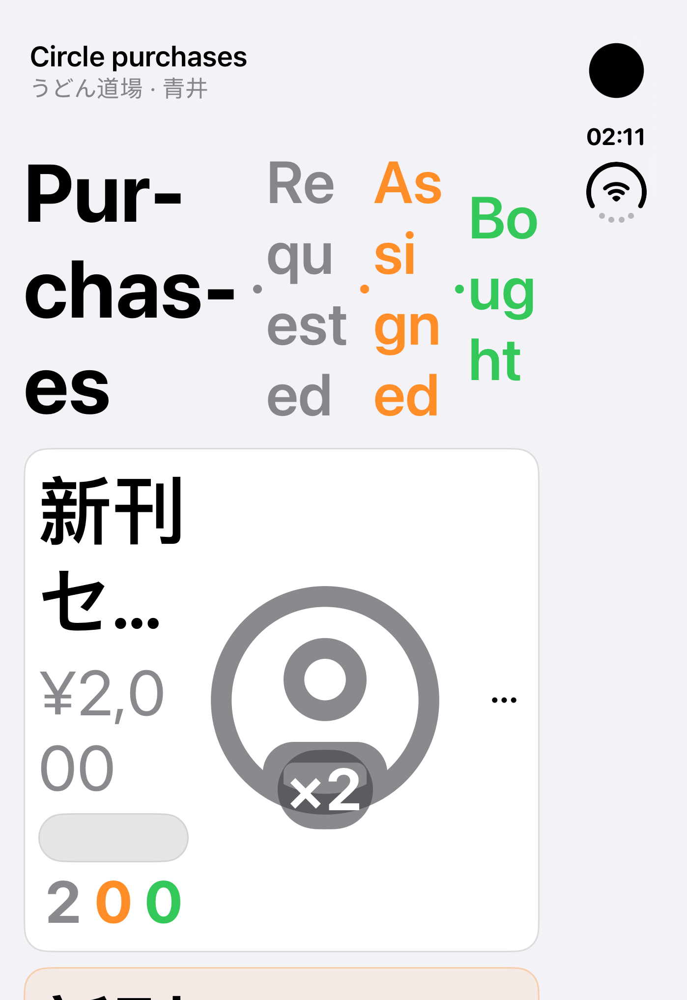
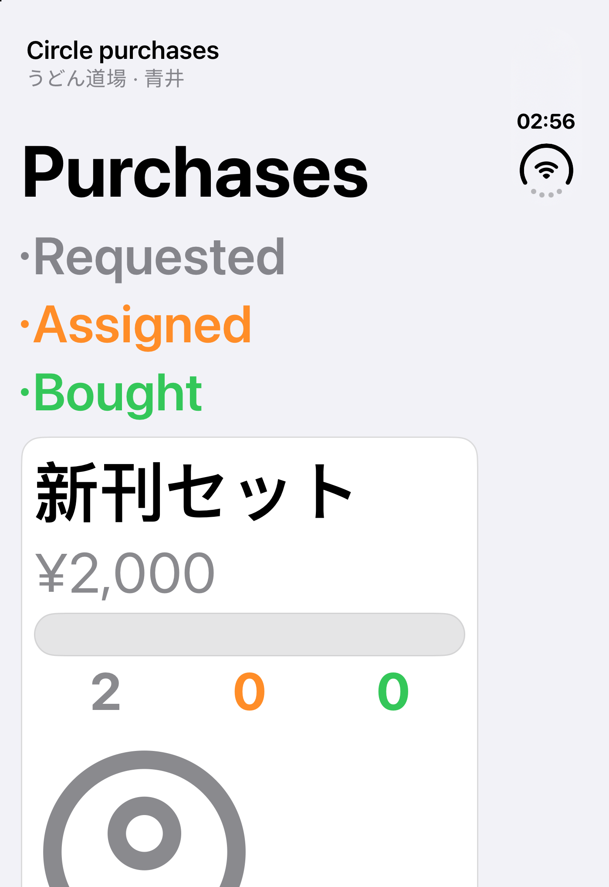

# ComiNavi iPhone Duo audit

Audit date: 2026-09-20. Scope: the iOS app, its actual navigation and rendering paths, local persistence tests, and accessible layouts. No backend deployment or App Store submission is included.

## Basis and environment

- [iPhone Duo Group Labs guide](https://gist.github.com/frankschlegel/6356a059426b2393528691822edfdae6).
- [Apple SwiftUI adaptive navigation](https://developer.apple.com/documentation/swiftui/tabview) and [container-relative layout](https://developer.apple.com/documentation/swiftui/view/containerrelativeframe(_:alignment:_:)).
- Xcode 27.1 beta, build 27A9269; iOS 27.1 simulator, build 24A94401.
- Dedicated existing iPhone Duo simulator `20F70A8B-0A22-4DC4-BA74-7004FF713400`. The other running Duo was not used for app installation.
- Commands explicitly select Xcode 27.1 through `DEVELOPER_DIR`; the machine's Xcode 26.6 default is unchanged.
- Deterministic catalog/demo and Shared Plan fixtures exercise the production screen components without changing a real account.

## Before and after

Maximum Dynamic Type on the native Duo display:

| Before | After |
|---|---|
|  |  |

## Changes

1. **Image-viewer continuity.** Resizing a zoomed image previously shifted the point being inspected. The viewer now retains its last stable image-space focus before UIKit clamps scroll offsets, restores it in the new viewport, and keeps the existing zoom where possible. Fitted images still refit normally. Tests cover repeated narrow/wide/landscape changes.
2. **Image-viewer safe areas.** Removed a second application of top and bottom safe-area insets. Controls use the safe container once; image content can still extend to the edges.
3. **Gallery width.** Item sizing, density selection, and pinch column alignment now use the available width after independently subtracting leading and trailing system insets. Moving a vertical bar no longer requires symmetric margins.
4. **Gallery accessibility and keyboard.** Initial density becomes one column at accessibility text sizes (two only in a sufficiently wide window). Fonts are measured using the collection's traits; text-size and inset changes invalidate cached header and cell layout. Explicit pinch choices remain user-controlled. Submitting a search explicitly dismisses the keyboard while preserving the query, keeping navigation reachable across layouts.
5. **Purchase planning accessibility.** At accessibility sizes, headings, stage legends, item information, buyers, and actions stack vertically with full-width item names. Normal text retains compact horizontal rows, while the header moves the legend below its title whenever both cannot fit without splitting words. Quantity labels move above their steppers at accessibility sizes, and the purchase-progress sheet expands to full height; normal-size users can expand it too. Removed the fixed multi-line name spacer for large text. Request menus now have 44-by-44-point targets. Purchase-progress Save/Cancel actions supply system symbols for vertical native bars; the matching fixture uses a symbol-backed Done action. The UI fixture and live editor share the same header and row components.
6. **Display ownership.** Map rendering takes the refresh rate from its owning window scene's screen when laid out, replacing the global `UIScreen.main` assumption.
7. **Localization.** Both Shared Plans tabs use the existing `Shared Plans` localization key, correcting the Japanese fallback in English. Empty text and numeric page fractions are explicitly non-translatable; all human-readable changes reuse existing translations.
8. **Unauthenticated startup.** Shared Plans now loads its local presentation without attempting a remote refresh when no user is bound. This removes the unrelated offline-error toast that appeared over the map as Duo prepared its tabs.
9. **Regression coverage.** Added unit tests for focus continuity, fitted-image resizing, asymmetric gallery insets, inset-only changes, and accessibility density. Added UI tests for day/search continuity across rotation, lightbox page and control continuity, and accessible purchase editing, with retained screenshots.

## Audit inventory

| Area | Finding and treatment |
|---|---|
| Scene lifecycle | App already uses `WindowGroup`. No fixed-screen orientation or full-screen-only opt-out added. |
| Tabs/navigation | Native `TabView` and `NavigationStack` already provide adaptive bars. Keep stable screen identity rather than branching whole hierarchies by device idiom. |
| Device checks | No phone-versus-iPad layout branch found in the active app. Layouts generally use container sizes or size classes. |
| Map | Existing custom controls sit inside the safe container; edge-to-edge map imagery is intentional. Camera/state persistence and search/location flows included in validation. Fixed screen ownership for frame rate. |
| Explore | Native toolbar actions adapt vertically. Fixed inset accounting and accessible density; search and day continuity exercised. |
| Circle detail | Scrollable content and system navigation/presentations. Detail selection and ordered image-viewer entry included in UI coverage. |
| Image viewer | Fixed focus continuity and duplicate safe-area spacing. Page selection, zoom, close/share/save reachability covered. |
| Catalog/day/filter sheets | Native sheets and scrollable controls; day selection, expanded filters, and dismissal included. |
| Shared Plans | Native navigation and sheets. Purchase rows had confirmed severe large-text wrapping; repaired. Plan switching and information navigation inspected; progress editing exercised. The older invitation-navigation test needs separate maintenance, as detailed below. |
| Profile and toolbox | Native navigation, forms, and scrollable destinations. Profile navigation and toolbox entry were exercised manually on Duo. Japanese sign-in passed its existing test. The older toolbox test still assumes a removed primary tab. |
| Authentication/account data | Layout work does not alter provider gates or credential flows. Full unit suite includes account isolation, logout/deletion, replay, and protected-storage checks. Live provider authorization is outside the simulator fixture run. |
| Localization | Existing Japanese, Korean, Simplified Chinese and Traditional Chinese catalog entries reused; localization tests verify coverage. |
| Accessibility | Largest Dynamic Type exercised, including gallery and purchases. System controls retain labels. Additional appearance and manual checks are recorded below. |

## Validation results

The final full Duo unit rerun in `build/DuoFinal.xcresult` passed **700 tests, with one real-C108 test skipped**. The final source also builds successfully with Xcode 27.1. In `build/DuoInteractions.xcresult`, the new primary-navigation/search continuity and lightbox continuity tests pass. Existing lightbox double-tap and selected-page share/save tests pass in `build/DuoFinal.xcresult`. After the toolbar-symbol fix, `build/DuoPurchaseFinal.xcresult` passes both the maximum-text purchase editing/dismissal test and the existing normal-size purchase-row/editor test. The accessible test increments Bought from 0 to 1 and activates the native vertical confirmation action successfully. The independent iPhone 17e / iOS 26.5 run `build/AdaptiveVerified.xcresult` passed all three new UI tests. It verifies real portrait/landscape changes, typed search preservation, selected-day preservation, all four primary destinations, lightbox page/control continuity and dismissal, and an actual Bought quantity increment at maximum Dynamic Type.

| Run | Result |
|---|---|
| Full Duo unit suite (`DuoFinal`) | 700 passed, 1 skipped, 0 failures |
| Duo navigation/search and lightbox continuity (`DuoInteractions`) | Both passed; purchase failures from this exploratory run were fixed and rerun separately |
| Duo final normal and maximum-text purchases (`DuoPurchaseFinal`) | 2 passed, 0 failures |
| Duo existing lightbox zoom and selected-page actions (`DuoFinal`) | Both passed |
| iPhone 17e / iOS 26.5 adaptive UI (`AdaptiveVerified`) | 3 passed, 0 failures |

The full unit run precedes the final keyboard-focus and toolbar-symbol changes; those final interaction changes were built and exercised by the focused Duo UI runs. This table describes passing checks across the named bundles, not a claim that every bundle or the complete historical UI suite passed.

Manual Duo checks:

- Native 466 × 678-point device layout, with asymmetric status/tab/tool bars on the right.
- DeviceHub live resize to 900 × 675, then 466 points wide, then restore native geometry. Explore adapted from two to three columns, changed system bar placement, and retained Day 2 plus the typed search `duo continuity`.
- Change Dynamic Type while Explore is already mounted: gallery changes to one column and enlarges metadata without horizontal clipping.
- Dark appearance and Reduce Transparency: gallery and toolbox remain readable; restored the original light appearance, normal text size, and transparency setting afterward.
- Profile opens and scrolls; Toolbox opens from Profile and uses the native vertical back control.

### Limits and older-test findings

- **Physical folding is not verified.** The installed Duo exposes two integrated displays, but display 3 remained black even after an explicit power-on. The beta also produced mismatches between logical orientation and the displayed framebuffer after rotation/display experiments, making some XCTest captures unsuitable as visual evidence. The independently reproduced large-text purchase confirmation issue is addressed by supplying native toolbar action symbols. Resetting only the audit simulator restored the native portrait framebuffer. Actual window resizing was exercised through DeviceHub and portrait/landscape rotation passed on iPhone 17e; physical pose transitions still need a working pose control or hardware.
- **The entire historical UI suite is not green.** An exploratory broader run exposed old assumptions: Toolbox is queried as a primary tab, back buttons are assumed to be inside a horizontal navigation bar, and plan-management controls are assumed to be immediately visible. Native-tab `firstMatch` queries also stalled. The new focused tests use direct button queries, dismiss the search keyboard before switching tabs, wait through rotation animations, and operate actual stepper buttons. Existing tests were left unchanged; these diagnostic failures are retained in `build/DuoValidation.xcresult`, `build/DuoAdaptive.xcresult`, and `build/AdaptiveCompatibility.xcresult`.
- Authentication, logout, deletion, offline persistence, CRDT conflict/sync, and export logic receive unit coverage. Live identity-provider login, APNs, production collaboration, and physical-device performance were not exercised. The real-C108 acceptance test requires separately downloaded raw databases and is skipped when they are absent.
- The audit also observed existing mixed Japanese/English copy in Profile and C108-specific Toolbox information while browsing the C104 demo. Those content/localization issues are outside this adaptive-layout change; screenshots retain them rather than disguising them.

### Evidence

Screenshots are unretouched simulator/XCTest captures. The native Duo screenshots are under `screenshots/`; standard-device regression images are separately labeled under `screenshots/iphone-17e/`.

| Check | Evidence |
|---|---|
| Large-text purchases before and after | [Before](screenshots/before-purchases-accessibility.png) · [After](screenshots/after-purchases-accessibility.png) |
| Native Duo map | [Map](screenshots/after-map.png) |
| Duo purchase quantity and vertical confirmation | [Maximum text](screenshots/after-purchase-progress-accessibility.png) · [Normal text](screenshots/purchase-progress-normal.png) |
| Native Duo image-viewer controls | [Lightbox](screenshots/after-lightbox.png) |
| Explore native narrow layout | [Narrow gallery](screenshots/explore-narrow.png) |
| Search retained across live resizing | [Wide](screenshots/explore-wide-search.png) · [Restored native layout](screenshots/explore-restored-search.png) |
| Dynamic Type, dark appearance, Reduce Transparency | [One-column gallery](screenshots/explore-accessibility-dark.png) |
| Toolbox navigation and dark appearance | [Toolbox](screenshots/toolbox-dark.png) |
| iOS 26.5 large-text quantity edit | [Bought quantity changed to 1](screenshots/iphone-17e/purchase-progress-accessibility.png) |
| iOS 26.5 actual landscape map and search | [Map](screenshots/iphone-17e/map-landscape.png) · [Search](screenshots/iphone-17e/explore-search-landscape.png) |
| iOS 26.5 lightbox landscape | [Lightbox](screenshots/iphone-17e/lightbox-4.png) |

The purchase comparison uses the same maximum Dynamic Type setting and the same deterministic data. The native image-viewer capture shows all three actions and the page indicator clear of the right-side system region.

Initial unsigned diagnostic run: 698 passed, 2 failed, 1 skipped. Failures were the non-linguistic localization entries (fixed) and a real Keychain test without simulator signing. Validation was rerun with normal ad-hoc simulator signing; the protected-storage behavior was not weakened to make the test pass.

## Delivery

Local branch: `codex/iphone-duo-audit`. Implementation checkpoints:

- `4141cc9`: adaptive gallery, image continuity, scene screen ownership, and initial accessibility fixes.
- `fb9fc14`: accessible purchase editing and adaptive screen-flow tests.
- `0e206a5`: reachable native purchase actions, normal Form structure, and search keyboard dismissal.
- `bef427a`: keep normal-size purchase legend words intact in narrow layouts.

Screenshots and this report are committed separately. No push, pull request, production deployment, or App Store submission was performed.

## Reproducing

```sh
export DEVELOPER_DIR=/Applications/Xcode-27.1.0-Beta.app/Contents/Developer
xcodebuild -project ComiNavi.xcodeproj -scheme ComiNavi \
  -destination 'platform=iOS Simulator,id=20F70A8B-0A22-4DC4-BA74-7004FF713400' \
  -derivedDataPath build/DuoDerivedData -parallel-testing-enabled NO \
  -only-testing:ComiNaviTests \
  -only-testing:ComiNaviUITests/ComiNaviAdaptiveLayoutTests \
  CODE_SIGN_IDENTITY=- test
```

Use a different result bundle path for each run. Screenshots captured with `simctl` specify `--display=1`; this simulator exposes an inactive second display that can otherwise produce an all-black capture.
